<h1 align="center">Sebastian Granados</h1>

  <b>Full Stack Developer</b> · Bogotá, Colombia 
  <i>Full stack, 8+ years — from the query up. I still learn something every week.</i>

  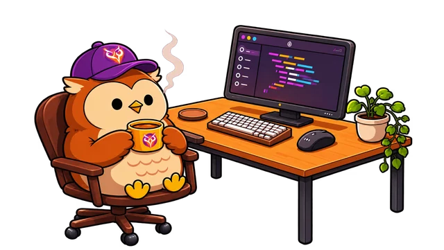

---

## About

Eight years building and repairing full stack products. Most of that time went into the parts
nobody demos: auditing queries, restructuring schemas, splitting a monolith into services. Along
the way, systems up to 80% faster and databases 60% lighter.

I work from Bogotá, across the whole stack — from the Postgres index to the React component. I
started at 15 and I am still self-taught in most of what I use, which is why I keep learning
something every week. Some of that escapes the browser: there are a few Arduino projects on my
desk.

  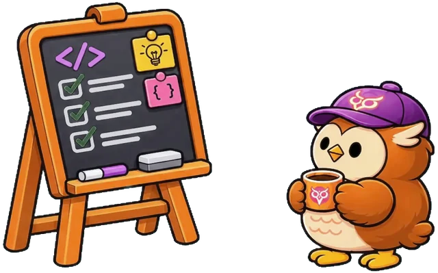

## Career

| | | |
|:--|:--|:--|
| **2025 — present** | Epayco | Full Stack Developer |
| **2018 — 2025** | Information Patterns | Principal Software Developer |
| **2017** | Recaudo Bogotá | Junior Developer |

## Stack

**Frontend**

  
  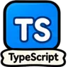
  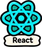
  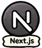
  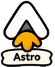
  
  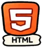
  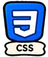
  

**Backend**

  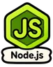
  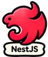
  
  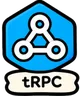
  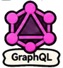
  
  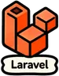
  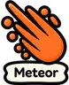
  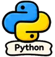

**Databases**

  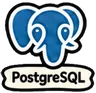
  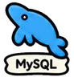
  
  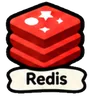
  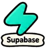
  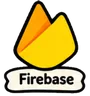

**DevOps**

  
  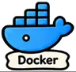
  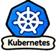
  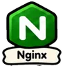
  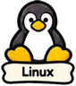
  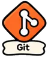
  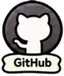

**Electronics**

  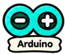
  

## Projects

  <a href="https://reactheroes.sebastiangranadosdev.com">
    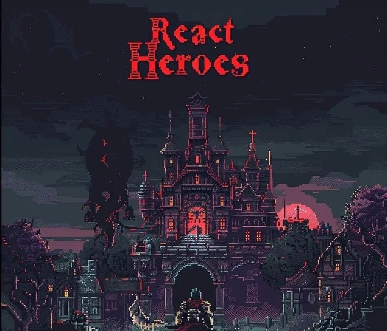
  </a>

**React Heroes** — 2024

Turn-based combat game with a branching story, where your decisions impact the plot's development.

## Contact

  
  
  

**sebastiangranadosdev@gmail.com** · [sebastiangranadosdev.com](https://sebastiangranadosdev.com)

  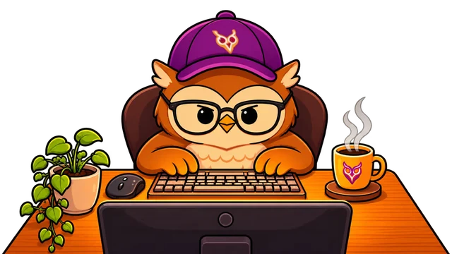

